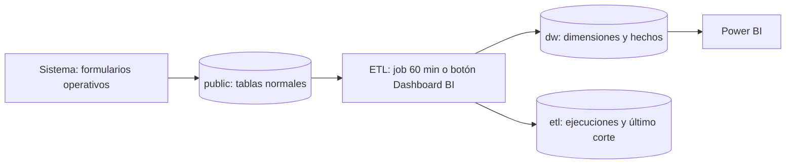

# Power BI: modelo y operación

Actualizado: **21 de noviembre de 2026**. El dashboard del sistema y el informe externo deben consultar exclusivamente `dw`. Los esquemas `public` (transacciones), `etl` (control de carga) y `bi` (compatibilidad antigua) no son fuentes del nuevo informe.

## Flujo de uso

1. En **Servicios**, confirmar el plan operativo y asignar personal. El supervisor ve y gestiona únicamente sus servicios; el servidor verifica también el acceso por ID.
2. En **Turnos**, registrar asistencia y ejecutar actividades, rondas y reportes. Las evidencias se adjuntan como imágenes. En reportes: **entregar → revisar → corregir y reenviar si fue observado → aprobar**. Cada revisión conserva texto, imágenes y versión de la entrega.
3. En **Incidencias**, registrar, atender y cerrar con sus plazos de atención y resolución. El tiempo de respuesta usa la primera atención, no el cierre.
4. En **Dashboard BI**, configurar metas mediante **definir vigencia y valores → revisar → guardar y sincronizar**. Administrador y jefe de operaciones pueden usar **Sincronizar datos**; el supervisor consulta sus resultados.
5. El job carga automáticamente cuando han pasado **60 minutos desde la última carga exitosa**. Una sincronización manual reinicia ese plazo. La API debe estar encendida; al reiniciar recupera una carga vencida. Para programadores externos existe `npm run bi:sync`. No ejecutar dos jobs externos innecesariamente.
6. Power BI consulta las tablas `dw`. En modo Import, programar aparte la actualización del conjunto de datos después del ETL; el botón actualiza PostgreSQL, no publica ni refresca por sí mismo el conjunto de datos de Power BI. En DirectQuery se consulta la última carga confirmada.



La separación es por esquemas en la misma base: **ninguna FK de `dw` referencia `public`, `bi` ni `etl`**. Los campos `*_origen_id` son valores de trazabilidad, no relaciones. El ETL necesariamente lee las transacciones para copiarlas; los reportes no las consultan. Las FK entre hechos y dimensiones pertenecen íntegramente a `dw`.

## Modelo Kimball

Se declara el grano antes de elegir medidas y se comparten dimensiones conformadas, siguiendo el [proceso de diseño de Kimball](https://www.kimballgroup.com/data-warehouse-business-intelligence-resources/kimball-techniques/dimensional-modeling-techniques/four-4-step-design-process/).

| Tabla de hechos | Grano: una fila por… | Dimensiones |
|---|---|---|
| `dw.fact_turno` | plaza-turno programada | Fecha, servicio, cliente, sede, supervisor, personal |
| `dw.fact_obligacion` | actividad o reporte requerido | Fecha del turno, servicio, cliente, sede, supervisor, tipo de obligación |
| `dw.fact_ronda` | ronda programada | Fecha del turno, servicio, cliente, sede, supervisor |
| `dw.fact_incidencia` | incidencia; snapshot acumulativo actualizado en cada carga | Fecha de registro, atención y cierre, servicio, cliente, sede, supervisor, tipo de incidencia |
| `dw.fact_servicio_diario` | servicio y día de vigencia contractual | Fecha, servicio, cliente, sede, supervisor |
| `dw.fact_meta` | indicador y tramo de vigencia de una meta | Indicador, fechas desde/hasta |

Las nueve dimensiones son `dim_fecha`, `dim_cliente`, `dim_sede`, `dim_supervisor`, `dim_personal`, `dim_servicio`, `dim_tipo_incidencia`, `dim_tipo_obligacion` y `dim_indicador`.

Cliente, sede, supervisor, personal y servicio tienen claves sustitutas `sk` y **SCD tipo 2**: `vigente_desde <= instante < vigente_hasta`, con una versión `actual` por ID de origen. Cambios de nombre, estado o asignación detectados en una carga cierran la versión anterior. Los hechos se enlazan a la versión correspondiente al instante del evento. Hay un miembro desconocido `0`; fechas sin dato usan `fecha_sk=0`. Tipos e indicadores usan actualización tipo 1. Las fechas contractuales corregidas se propagan como tipo 1 a las versiones de servicio para reconstruir su calendario.

**Límite del historial:** la primera carga conserva la información que existe al instalar el modelo. No permite reconstruir asignaciones de supervisores anteriores que nunca se registraron. Los cambios futuros se historizan desde su detección por ETL. Si un atributo cambia varias veces entre dos cargas, se conserva el valor observado en la carga siguiente. Los estados y contadores de hechos corresponden al último corte; seleccionar un mes anterior agrupa sus eventos con su situación conocida actualmente, no reproduce un cierre contable congelado de ese mes.

En Power BI crear relaciones **1:​***, unidireccionales, desde las dimensiones a cada hecho por sus claves. No relacionar hechos entre sí ni enlazar las dimensiones mediante IDs operativos. `dim_fecha.fecha_sk → fact_*.fecha_sk` es la relación de fecha principal; en incidencias corresponde al registro. Para atención y cierre usar copias de la dimensión de fecha o relaciones inactivas activadas por medidas específicas. Para metas, la selección es por intervalo; no activar simultáneamente relaciones de fecha desde/hasta.

## Definición de los indicadores

Un turno es exigible cuando terminó antes del corte. Se considera cubierto cuando tiene ingreso validado antes de su fin. Las tardanzas respetan la tolerancia configurada. La asistencia pendiente se muestra como problema de calidad, no se convierte en ausencia validada.

Las actividades/reportes/rondas son exigibles al vencer su plazo. Los completados se cuentan dentro del conjunto exigible; terminar anticipadamente una obligación futura no adelanta el denominador. Una incidencia tiene resolución exigible si venció su SLA o ya se cerró. Los registros sin SLA se excluyen del denominador y se señalan como calidad pendiente.

| Código | Cálculo |
|---|---|
| I00 | Servicios activos al último día seleccionado; nunca sumar los activos diarios de un mes |
| I01 | Cubiertos / turnos exigibles × 100 |
| I02 | Turnos exigibles sin presencia validada |
| I03 | Ausencias validadas / turnos asignados exigibles con asistencia validada × 100 |
| I04 | Tardanzas / turnos con asistencia validada × 100 |
| I09 | Actividades completadas / actividades exigibles × 100 |
| I10 | Actividades exigibles aún pendientes |
| I11 | Reportes cuya **primera entrega** fue dentro del plazo / reportes exigibles × 100 |
| I12 | Reportes observados al menos una vez / reportes revisados al menos una vez × 100 |
| I13 | Incidencias registradas en el periodo |
| I14 | Incidencias / turnos exigibles × 1.000 |
| I15 | Mediana de minutos desde registro hasta primera atención; excluye casos sin atención |
| I16 | Incidencias cerradas dentro de su SLA / incidencias con resolución exigible × 100 |
| I17 | Incidencias registradas en el periodo que siguen abiertas al corte |

I00, I12 e I17 aclaran etiquetas ambiguas del mockup. Un reporte observado y luego aprobado sigue contando una sola vez como observado; no se infla por sus revisiones. I17 es la tarjeta de abiertas, mientras I16 corresponde al porcentaje de cierre oportuno de la tabla. Los números del mockup son ilustrativos; las metas iniciales son referencias editables y los resultados se calculan con datos reales de la base.

Si no hay denominador, el resultado es vacío, no 0 %. Las variaciones porcentuales son **puntos porcentuales**; tiempos y cantidades usan diferencia absoluta. Las metas usan la vigencia del último día del periodo elegido. Los porcentajes, tasas y medianas se recalculan desde sus hechos; no se promedian porcentajes ni medianas parciales.

## DAX de referencia

Usar los nombres de tablas sin prefijo de esquema si así los importa Power BI. Las tasas siguientes se muestran como números 0–100; no aplicarles formato porcentual que vuelva a multiplicar por 100.

```dax
I00 Servicios activos =
VAR UltimaFecha = MAX(dim_fecha[fecha])
RETURN CALCULATE(SUM(fact_servicio_diario[activo]), dim_fecha[fecha] = UltimaFecha)

I01 Cobertura = 100 * DIVIDE(SUM(fact_turno[cubiertos]), SUM(fact_turno[exigibles]))
I02 Descubiertos = SUM(fact_turno[descubiertos])
I03 Ausentismo = 100 * DIVIDE(SUM(fact_turno[ausentes]), SUM(fact_turno[asignados_validados]))
I04 Tardanzas = 100 * DIVIDE(SUM(fact_turno[tardanzas]), SUM(fact_turno[asistencias]))

I09 Actividades =
CALCULATE(100 * DIVIDE(SUM(fact_obligacion[completadas]), SUM(fact_obligacion[exigibles])), dim_tipo_obligacion[nombre] = "actividad")
I10 Vencidas =
CALCULATE(SUM(fact_obligacion[pendientes_vencidas]), dim_tipo_obligacion[nombre] = "actividad")
I11 Reportes oportunos =
CALCULATE(100 * DIVIDE(SUM(fact_obligacion[oportunas]), SUM(fact_obligacion[exigibles])), dim_tipo_obligacion[nombre] = "reporte")
I12 Reportes observados =
CALCULATE(100 * DIVIDE(SUM(fact_obligacion[observados]), SUM(fact_obligacion[revisados])), dim_tipo_obligacion[nombre] = "reporte")

I13 Incidencias = SUM(fact_incidencia[cantidad])
I14 Incidencias por mil = 1000 * DIVIDE([I13 Incidencias], SUM(fact_turno[exigibles]))
I15 Mediana respuesta = MEDIAN(fact_incidencia[minutos_respuesta])
I16 Cierre oportuno = 100 * DIVIDE(SUM(fact_incidencia[cerradas_en_plazo]), SUM(fact_incidencia[resolucion_exigible]))
I17 Abiertas = SUM(fact_incidencia[abiertas])

Meta seleccionada =
VAR FechaCierre = MAX(dim_fecha[fecha])
RETURN CALCULATE(MAX(fact_meta[valor]),
  FILTER(fact_meta, fact_meta[vigente_desde] <= FechaCierre &&
    (ISBLANK(fact_meta[vigente_hasta]) || fact_meta[vigente_hasta] >= FechaCierre)))
```

En la tabla de metas seleccionar también `dim_indicador[codigo]`. Marcar `dim_fecha` como tabla de fechas excluyendo el miembro sin fecha de ese calendario de inteligencia temporal. Limitar el filtro de periodo al último corte disponible; el calendario incluye años futuros para plazos y metas. Para evolución mensual usar `anio` y `mes`, con orden numérico, y recalcular cada medida. El dashboard web compara ventanas equivalentes (7/30/90/180 días); una comparación por mes completo en Power BI debe usar la misma ventana si se pretende igualdad exacta.

## Carga, acceso e instalación

La carga toma un snapshot transaccional consistente y reconstruye los hechos sin duplicarlos. Un advisory lock impide cargas simultáneas. La sustitución de hechos y actualización del corte se confirman juntas: si falla, el último DW válido permanece disponible. `etl.ejecuciones` registra origen, duración, conteos y errores; `etl.estado` conserva el último corte exitoso. Las claves de hechos no deben usarse como referencias externas permanentes, porque la reconstrucción puede regenerarlas. Las claves de dimensiones sí conservan versiones.

El lector de Power BI debe tener solamente `USAGE` y `SELECT` en `dw`; ejecutar `acceso-power-bi.sql` como propietario para instalar el grupo `bi_lector`, y agregar al grupo un usuario de conexión gestionado por el administrador. No usar las credenciales de la API para Power BI. El SQL de exportación omite roles del servidor y privilegios; después de restaurar, volver a aplicar ese archivo.

Las restricciones del supervisor se aplican inmediatamente en la API con su asignación operativa actual, incluso si el DW aún no sincronizó. **Un informe publicado en Power BI requiere además RLS y acceso autenticado configurados en Power BI**; un iframe o enlace público no hereda las restricciones de la aplicación. No se habilita acceso público automático ni se crean credenciales externas.

Instalación existente: `npm run db:migrate`, arrancar API o `npm run bi:sync`. Instalación nueva: `instalacion/01_creacion_completa.sql` y luego `02_inserts_ejemplo.sql`, o ruta modular `schema.sql → seed.sql → migraciones → views_bi.sql → bi:sync`. Los exports incluyen `public`, `bi`, `dw` y `etl`; `bi` queda solo para compatibilidad. Reiniciar la API tras desplegar el código.

Datos sintéticos: `npm run db:demo:bi` complementa únicamente servicios `DEMO-SRV-*` en una base marcada `datos_demo=true`, añade muestra semanal de seis meses, revisiones e incidencias; es repetible. No ejecutar generadores de demostración en producción. La muestra no inventa valores para operaciones de usuarios.

## Módulos y tablas modificados

| Módulo | Cambio | Tablas normales |
|---|---|---|
| Servicios | Alcance obligatorio del supervisor, catálogos y rutas por ID protegidos | `servicios`, `personal`, `servicio_personal`: uso de relaciones existentes, sin nuevas columnas |
| Turnos / reportes | Primera entrega, versión, revisión y corrección con historial de evidencias | `obligaciones_operativas`: 5 columnas; nueva `revisiones_reportes` |
| Dashboard BI | Datos solo del DW, carga manual/automática, filtros, comparaciones, calidad y flujo de metas | Nuevas `indicadores_bi`, `metas_bi` |
| Proceso ETL | Snapshot, exclusión mutua, registro y recuperación de fallos | Nuevas `etl.estado`, `etl.ejecuciones`; 9 dimensiones y 6 hechos en `dw` |
| Instalación / demo / respaldo | Exportación íntegra, muestra histórica, restauración verificable | Se incluyen los cuatro esquemas |

Las migraciones `011` a `015` contienen estos cambios. El monitor multicriterio conserva sus 5 criterios/10 KPI y no vuelve a mostrar el botón de captura que se pidió retirar. El Dashboard BI usa su propio catálogo operativo de 14 indicadores del mockup.


## Ampliaciones de incidencias y análisis por agente (21/11/2026)

El módulo Incidencias sigue reportar → iniciar atención → registrar avances/corrección con fotografías → resolver. El operador responsable ejecuta la corrección. El supervisor del servicio (o jefatura/administrador) decide las solicitudes de ampliación con justificación; nadie decide su propia solicitud. La petición pendiente no detiene el reloj ni elimina la alerta roja. Al resolver se cancelan peticiones pendientes. Las incidencias antiguas asignadas a supervisión pueden reasignarse a un agente operativo activo del servicio con cuenta de operador, desde el propio seguimiento. No se modifican automáticamente responsables históricos.

`public.incidencias` añade `evidencias` y `plazo_resolucion_extendido`. `public.incidencias_seguimiento` conserva acciones, comentarios, fotografías y autores; `public.incidencias_ampliaciones` conserva cada petición, sus plazos, motivo, estado y decisión. La migración 014 instala estas estructuras; 015 actualiza el ETL sin introducir relaciones entre esquemas.

`dw.fact_incidencia.limite_resolucion` corresponde al plazo aprobado vigente. Para auditoría se añaden `limite_resolucion_original`, `ampliaciones_aprobadas`, `minutos_ampliados` y `ampliacion_pendiente`. I16 se calcula contra el plazo efectivo aprobado; el plazo original permanece disponible para comparaciones. Una solicitud pendiente no altera la exigibilidad. El monitor aplica el mismo plazo efectivo para C05.

En Prioridades, el detalle se abre en modal. Se listan agentes actualmente asignados y agentes con operación en el periodo. Al elegir uno, sus turnos determinan asistencia, puntualidad y obligaciones (protocolos, consignas, actividades, rondas y reportes); las incidencias se atribuyen por `responsable_id`. No se reparten cifras del servicio entre agentes ni se atribuyen sus vacantes a una persona. Un agente sin programación conserva el estado sin datos, con los KPI específicos que tengan casos disponibles.

Las pruebas de este cambio son automáticas: `node analisis/verificar-flujo-incidencias.cjs` desde la raíz crea PostgreSQL temporal, verifica API, roles, imágenes requeridas, ampliaciones, DW y aislamiento del análisis por agente. No abre navegador ni interactúa con la interfaz. El generador de demostración agrega DFL-001 (petición pendiente y plazo vencido), DFL-002 (rechazo) y DFL-003 (aprobación) cuando existen un operador y un supervisor asignados al mismo servicio. Los códigos son sintéticos y la ejecución repetida no los duplica.


## Correcciones de presentación y datos de ejemplo (21/11/2026)

El cálculo multicriterio se presenta en tarjetas por criterio, con sus dos KPI y métricas en bloques adaptables, sin tabla horizontal. El detalle de agente incluye totales de incidencias resueltas, en proceso y por atender. Las incidencias reales cuyo responsable siga siendo supervisión se identifican como no atribuidas a operadores.

El selector de responsables lista todos los agentes activos asignados al servicio; si alguno aún no tiene cuenta, se informa sin ocultarlo del selector. La asignación y la habilitación de acceso son pasos distintos. El comando de actualización de demostración prepara las cuentas sintéticas faltantes (contraseña de demostración `DemoSegur2026!`), vincula las incidencias de ejemplo al agente del turno o a un agente encargado del servicio y crea seis estados por agente, además de solicitudes pendientes/aprobadas/rechazadas por servicio. Conserva el historial de seis meses y los registros ingresados por usuarios.
